# Tugas Express Database

`REST API` untuk mengelola data produk dengan `Express.js`, `PostgreSQL`, dan `Prisma ORM`.

| Kelas | NRP | Nama |
| --- | --- | --- |
| Pemrograman Web A | 5027251**036** | Jonathan Steven Tjahjaputra

## Setup

1. Pastikan `Node.js` dan `npm` sudah terinstal. Siapkan juga database `PostgreSQL` yang dapat diakses dari komputer Anda.
2. Buka folder proyek di VS Code, lalu buka terminal (`Ctrl + backtick`).
3. Instal dependencies proyek:

   ```sh
   npm install
   ```

4. Buat file `.env` di folder utama proyek dan isi `DATABASE_URL` dengan connection string database PostgreSQL Anda:

   ```env
   DATABASE_URL="ISI_DENGAN_CONNECTION_STRING_POSTGRESQL_ANDA"
   ```

   Ganti nilai tersebut dengan connection string PostgreSQL lengkap dari penyedia database Anda. Sesuaikan opsi SSL dengan konfigurasi penyedia database.
5. Buat Prisma Client dan terapkan migrasi tabel produk:

   ```sh
   npx prisma generate --config prisma.config.js
   npx prisma migrate deploy --config prisma.config.js
   ```

   Migrasi membuat tabel `Product` dengan kolom `id`, `name`, dan `price`. Tabel baru belum berisi data.
6. Jalankan server dalam mode development:

   ```sh
   npm run dev
   ```

Server berjalan di `http://localhost:3000`. Untuk melihat isi tabel melalui Prisma Studio, buka terminal lain dan jalankan:

```sh
npx prisma studio --config prisma.config.js
```

## Endpoint

| Method | Endpoint | Deskripsi | Respons |
| --- | --- | --- | --- |
| `GET` | `/products` | Menampilkan seluruh produk | `200 OK` |
| `GET` | `/products/:id` | Menampilkan produk berdasarkan ID | `200 OK`, `404 Not Found` jika tidak ditemukan |
| `POST` | `/products` | Menambahkan produk dengan body JSON `name` dan `price` | `201 Created`, `400 Bad Request` jika data tidak valid |
| `PUT` | `/products` atau `/products/:id` | Memperbarui produk dengan `id`, `name`, dan `price` di body JSON | `200 OK`, `400 Bad Request` atau `404 Not Found` |
| `DELETE` | `/products/:id` | Menghapus produk berdasarkan ID | `200 OK`, `400 Bad Request` atau `404 Not Found` |

## Testcase dengan Postman

Pastikan server berjalan di `http://localhost:3000` dan database sudah dimigrasikan sebelum mengirim request. Untuk request dengan body, pilih **Body** → **raw** → **JSON**.

### 1. Memastikan tabel produk sudah dibuat

- Buka Prisma Studio dan pilih tabel `Product`.
- Hasil: tabel memiliki kolom `id`, `name`, dan `price`, serta belum berisi data.

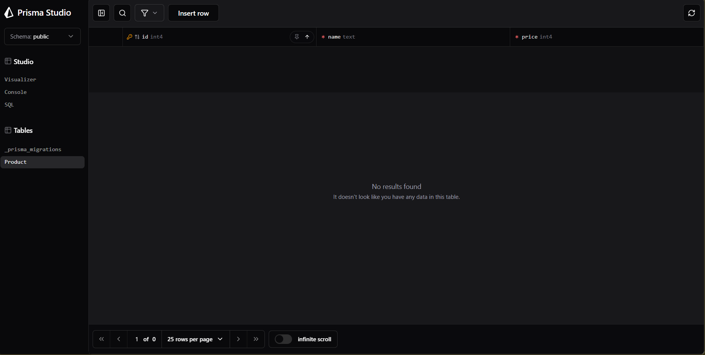

### 2. Gagal menambahkan produk dengan nama kosong — `POST /products`

- Pilih method `POST` dan masukkan URL `http://localhost:3000/products`.
- Masukkan body:

  ```json
  {
    "name": ""
  }
  ```

- Klik **Send**.
- Hasil: `400 Bad Request` dengan pesan validasi bahwa `name` harus diisi berupa teks.

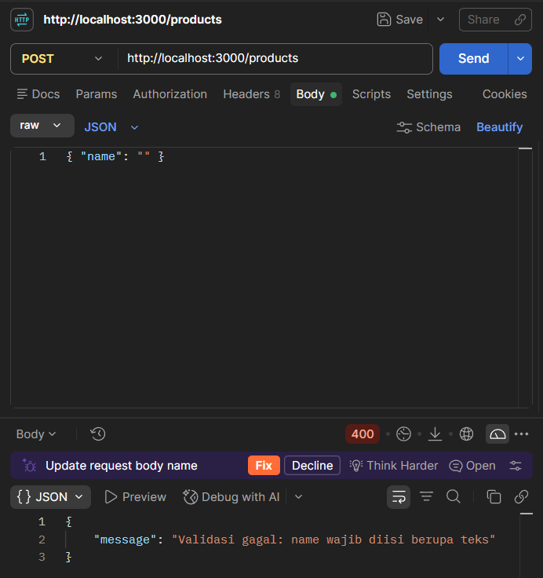

### 3. Menambahkan produk Buku — `POST /products`

- Kirim request `POST` ke `http://localhost:3000/products` dengan body:

  ```json
  {
    "name": "Buku",
    "price": 15000
  }
  ```

- Hasil: `201 Created` dengan data produk Buku dan `id` yang dibuat otomatis.

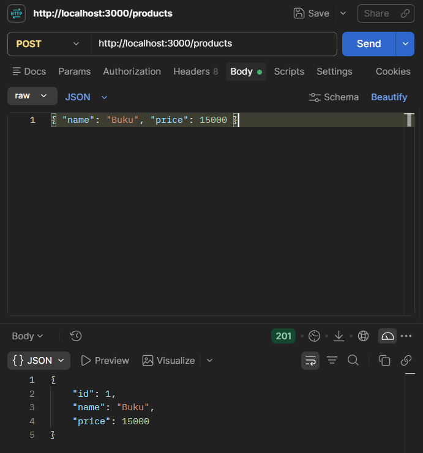

### 4. Menambahkan produk Pulpen — `POST /products`

- Kirim request `POST` ke `http://localhost:3000/products` dengan body:

  ```json
  {
    "name": "Pulpen",
    "price": 5000
  }
  ```

- Hasil: `201 Created` dengan data produk Pulpen dan `id` yang dibuat otomatis.

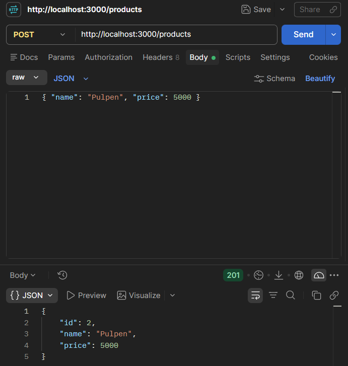

### 5. Memastikan kedua produk tersimpan

- Kembali ke Prisma Studio dan refresh tabel `Product`.
- Hasil: tabel berisi produk Buku dan Pulpen.

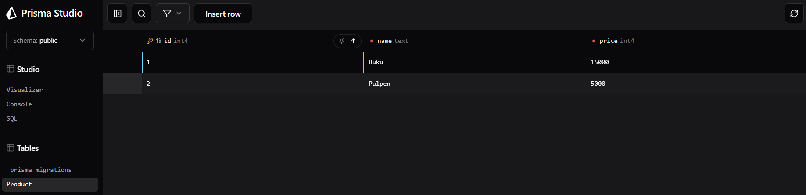

### 6. Gagal memperbarui produk yang tidak ditemukan — `PUT /products`

- Pilih method `PUT` dan masukkan URL `http://localhost:3000/products`.
- Masukkan body:

  ```json
  {
    "id": 999,
    "name": "Buku Baru",
    "price": 20000
  }
  ```

- Klik **Send**.
- Hasil: `404 Not Found` karena produk dengan ID `999` tidak ditemukan.

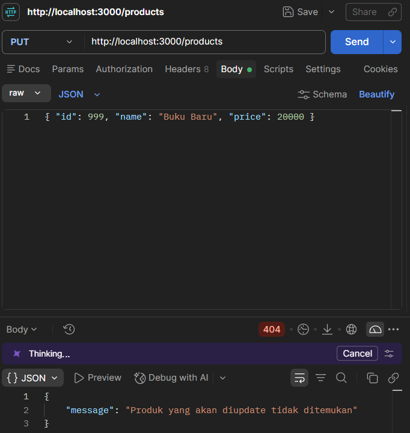

### 7. Menampilkan seluruh produk — `GET /products`

- Pilih method `GET` dan masukkan URL `http://localhost:3000/products`.
- Klik **Send**.
- Hasil: `200 OK` dengan daftar produk Buku dan Pulpen.

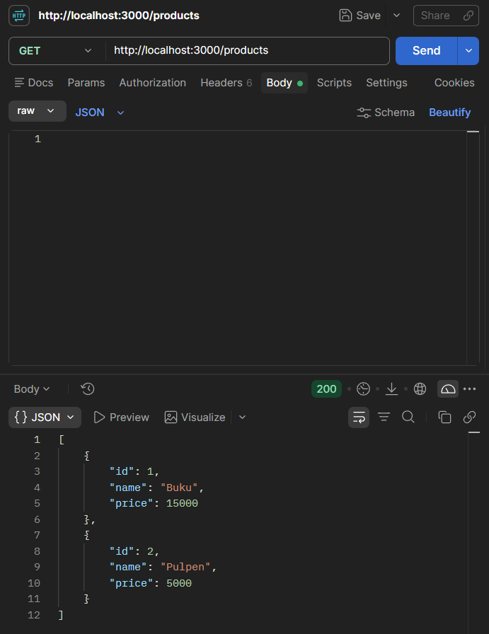

### 8. Memperbarui produk Buku — `PUT /products`

- Pilih method `PUT` dan masukkan URL `http://localhost:3000/products`.
- Masukkan body:

  ```json
  {
    "id": 1,
    "name": "Buku Tulis Kampus",
    "price": 20000
  }
  ```

- Klik **Send**.
- Hasil: `200 OK` dengan data produk yang sudah diperbarui. Periksa juga Prisma Studio untuk memastikan perubahan tersimpan di database.

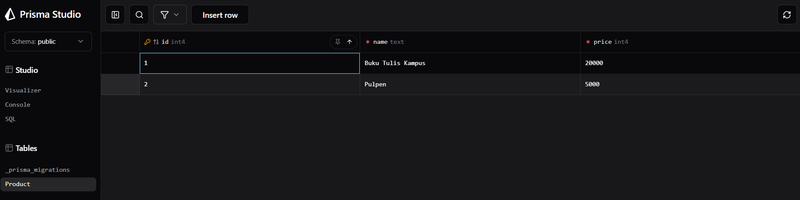

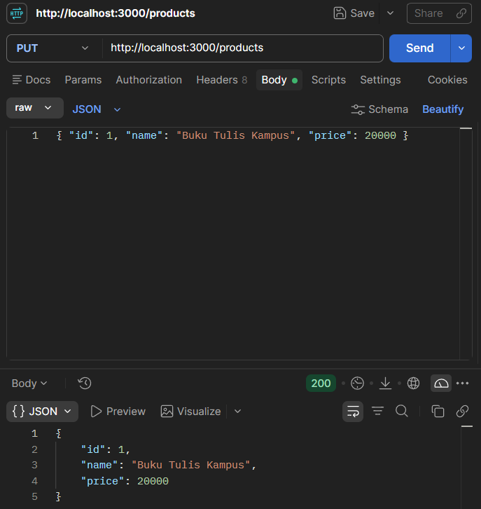

### 9. Gagal menghapus produk yang tidak ditemukan — `DELETE /products/2`

- Testcase ini mengharapkan produk dengan ID `2` tidak ada di database. Jika produk tersebut masih ada dari testcase sebelumnya, hapus melalui Prisma Studio sebelum mengirim request.
- Pilih method `DELETE` dan masukkan URL `http://localhost:3000/products/2`.
- Klik **Send**.
- Hasil: `404 Not Found` karena produk dengan ID `2` tidak ditemukan.

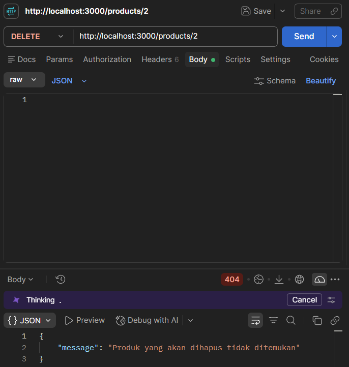

### 10. Menghapus produk Pulpen — `DELETE /products/2`

- Pastikan produk dengan ID `2` tersedia di database (tambahkan kembali melalui Prisma Studio jika sudah dihapus pada testcase sebelumnya).
- Pilih method `DELETE` dan masukkan URL `http://localhost:3000/products/2`.
- Klik **Send**.
- Hasil: `200 OK` dengan pesan bahwa produk ber-ID `2` berhasil dihapus.

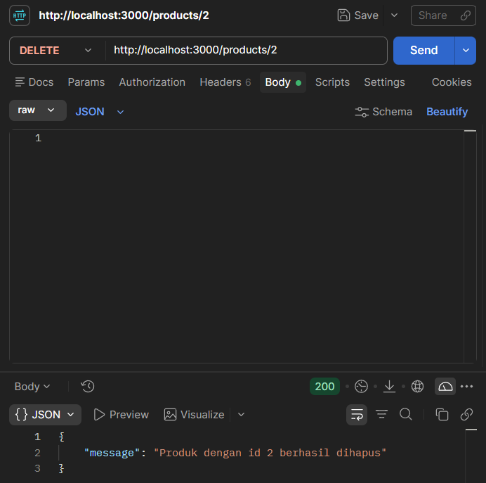

### 11. Memastikan produk berhasil dihapus

- Kembali ke Prisma Studio dan refresh tabel `Product`.
- Hasil: produk Pulpen sudah terhapus dan produk dengan ID `1` tetap tersimpan.

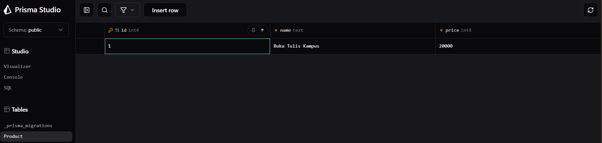