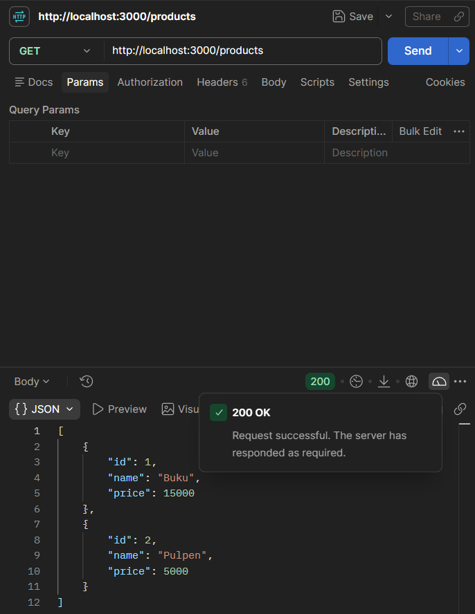
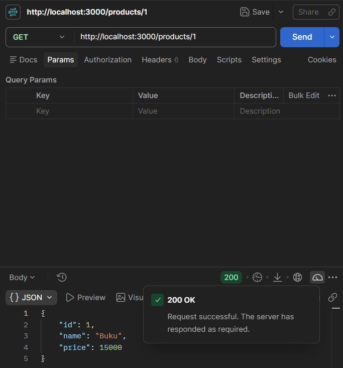
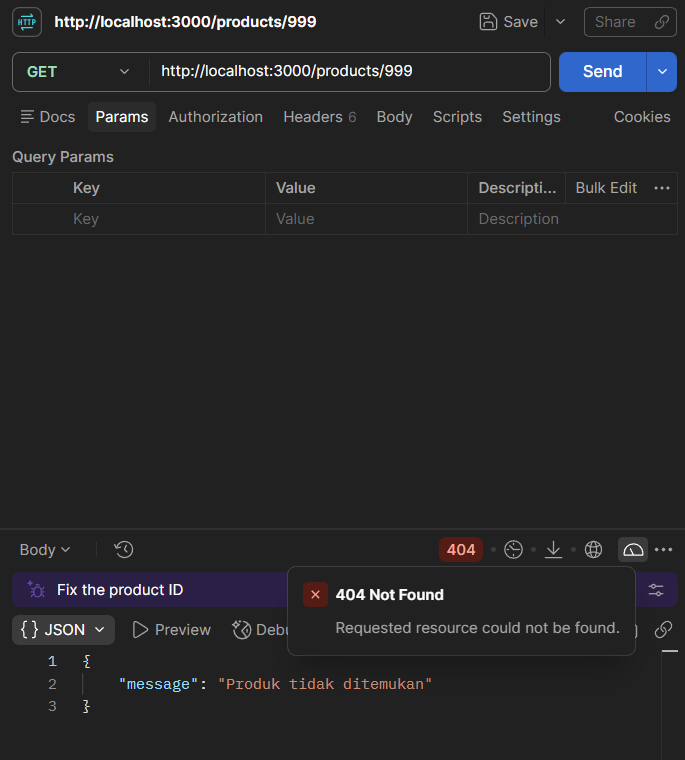
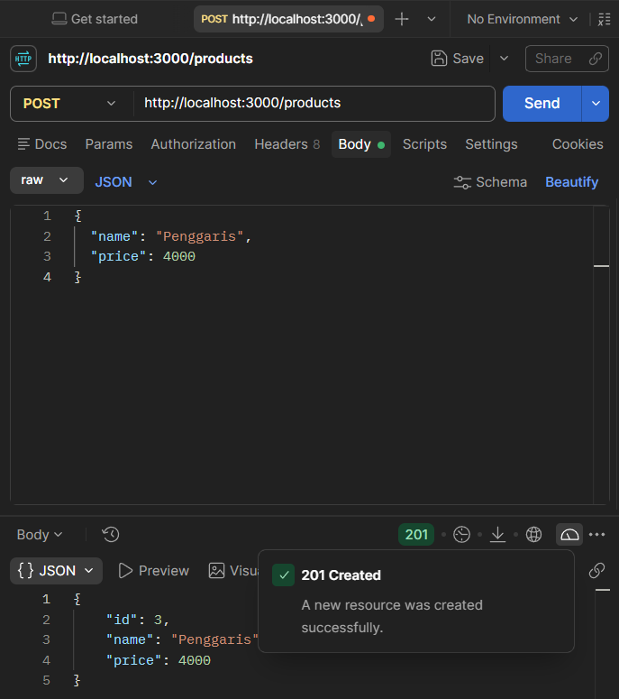

# Tugas API Daftar Produk

`REST API` sederhana untuk mengelola daftar produk menggunakan `Express.js`.

| Kelas | NRP | Nama |
| --- | --- | --- |
| Pemrograman Web A | 5027251**036** | Jonathan Steven Tjahjaputra

## Setup
1. Pastikan `Node.js` sudah terinstal di komputer Anda (cek di terminal dengan perintah: `node -v`).
2. Buka folder kosong di VS Code, lalu buka terminal (` Ctrl + backtick `).
3. Inisialisasi proyek `Node.js` dengan perintah:
   `npm init -y`
4. Instal framework `ExpressJS` dengan perintah:
   `npm install express`
5. Instal `TypeScript` beserta tipe data dan runner (`tsx`) sebagai `devDependencies` dengan perintah:

    ```sh
   npm install -D typescript tsx @types/node @types/express
   ```

6. Buka file `package.json`, tambahkan konfigurasi `"type": "module"` dan `script "dev": "tsx watch src/index.ts"`.
7. Buat file `tsconfig.json` di folder utama (sejajar dengan `package.json`) untuk mengatur konfigurasi kompilasi TypeScript.
8. Buat struktur folder di dalam direktori proyek:
    ```sh
   mkdir -p src/controllers src/routes src/middleware
   ```

## Menjalankan Proyek

1. Buka terminal di direktori proyek.
2. Install dependencies:

   ```sh
   npm install
   ```

3. Jalankan server dalam mode development:

   ```sh
   npm run dev
   ```

Server berjalan di `http://localhost:3000`.

## Endpoint

| Method | Endpoint | Deskripsi | Respons |
| --- | --- | --- | --- |
| `GET` | `/products` | Menampilkan seluruh produk | `200 OK` |
| `GET` | `/products/:id` | Menampilkan produk berdasarkan ID | `200 OK`, `404 Not Found` jika tidak ditemukan |
| `POST` | `/products` | Menambahkan produk dengan body JSON `name` dan `price` | `201 Created`, `400 Bad Request` |

## Pengujian dengan Postman

Pastikan server sudah berjalan di `http://localhost:3000` sebelum mengirim request.

### 1. Menampilkan seluruh produk — `GET /products`

- Buat tab request baru di Postman.
- Pilih method `GET`.
- Masukkan URL `http://localhost:3000/products`.
- Klik **Send**.
- Hasil: `200 OK` dengan body JSON berisi produk Buku dan Pulpen.




### 2. Menampilkan produk berdasarkan ID — `GET /products/1`

- Pilih method `GET`.
- Masukkan URL `http://localhost:3000/products/1`.
- Klik **Send**.
- Hasil: `200 OK` dengan objek produk Buku yang memiliki `id` `1`.




### 3. Menampilkan produk dengan ID yang tidak ditemukan — `GET /products/999`

- Pilih method `GET`.
- Masukkan URL `http://localhost:3000/products/999`.
- Klik **Send**.
- Hasil: `404 Not Found` dengan pesan bahwa produk tidak ditemukan.




### 4. Menambahkan produk baru — `POST /products`

- Pilih method `POST`.
- Masukkan URL `http://localhost:3000/products`.
- Buka tab **Body**, pilih **raw**, lalu ubah format menjadi **JSON**.
- Masukkan data berikut ke dalam kolom Body:

  ```json
  {
    "name": "Penggaris",
    "price": 4000
  }
  ```

- Klik **Send**.
- Hasil: `201 Created` dengan objek produk baru dan ID yang dibuat otomatis (`id: 3`).



